# SmartBus

## Miembros del grupo L5-01

1. Espina Apellaniz, David
2. Pérez Gómez, Juan
3. Mukhiddinov, Dilyorbek
4. Oña Conde, Luis

## 1. Introducción al problema

El transporte público en Sevilla, gestionado por TUSSAM, cuenta con una aplicación móvil que usamos a diario, pero que actualmente presenta varios fallos que complican el día a día de los usuarios. Uno de los problemas más comunes y frustrantes es el desajuste en los tiempos de espera; muchas veces la app marca que quedan "3 minutos" para que llegue un autobús que nunca aparece en el tiempo esperado. Además, la aplicación no da ninguna información sobre la ocupación del vehículo. Esto provoca que te quedes esperando en la parada porque la app te indica que el bus está llegando, pero cuando por fin aparece va al 100% de capacidad y no puedes subirte, haciendo que la espera no haya servido de nada. Por otro lado, el método de pago se ha quedado bastante anticuado. En una época en la que casi todo se paga con el móvil mediante NFC (como Apple Pay o Google Pay), el sistema nos sigue obligando a depender exclusivamente de la tarjeta física del bonobús, impidiendo viajar si te la olvidas en casa.

Para solucionar todos estos problemas, en este proyecto proponemos el desarrollo de un nuevo sistema de información llamado "SmartBus". La idea es que esta plataforma integre el aforo en tiempo real de los vehículos junto con una posición GPS más precisa, avisando desde la app si un autobús ya va completo para que la persona pueda buscar una alternativa. También vamos a diseñar el sistema para virtualizar los títulos de transporte actuales, permitiendo a los usuarios vincular su bonobús al móvil para acceder y pagar el viaje directamente acercando el teléfono, igual que hacemos con las tarjetas bancarias.

## 2. Glosario de términos

- Aforo en tiempo real: Número actual de pasajeros a bordo de un autobús en un momento dado.

- Bonobús virtual: Título de transporte digitalizado y almacenado en el teléfono móvil del usuario.

- NFC: Tecnología inalámbrica de corto alcance que permite validar el viaje acercando el móvil a la máquina.

- Sistema de Ayuda a la Explotación (SAE): Servidor central que controla por GPS la posición, horarios y rutas de toda la flota de autobuses.

- Título de transporte: Soporte físico o digital (billete sencillo, tarjeta mensual, abono) que da derecho a viajar.

- Transbordo: Cambio a otra línea de autobús dentro de un margen de tiempo determinado, aplicando un descuento o coste cero.

- Validación: Acción de registrar el viaje en la máquina al subir, comprobando los permisos y descontando el saldo.

- Validadora: Máquina instalada en el autobús donde el pasajero acerca su tarjeta o móvil para pagar.

## 3. Visión general del sistema

### 3.1. Requisitos generales

#### R.G.01. Mejorar la precisión de la información del transporte

Como usuario del transporte público, quiero consultar información precisa y actualizada sobre la ubicación y el tiempo estimado de llegada de los autobuses, para planificar mejor mis desplazamientos.

#### R.G.02. Consultar la ocupación de los autobuses

Como usuario del transporte público, quiero conocer el nivel de ocupación de los autobuses antes de que lleguen a mi parada, para poder elegir la mejor alternativa de transporte.

#### R.G.03. Digitalizar los títulos de transporte

Como usuario del transporte público, quiero utilizar mi bonobús desde el teléfono móvil, para poder pagar y validar mis viajes sin depender exclusivamente de una tarjeta física.

#### R.G.04. Facilitar la gestión del transporte

Como responsable de la gestión del transporte, quiero disponer de información actualizada sobre la ubicación y la ocupación de los autobuses, para mejorar el seguimiento del servicio y la información proporcionada a los pasajeros.

#### R.G.05. Centralizar la gestión de los diferentes perfiles de usuario

Como administrador del sistema, quiero disponer de un registro centralizado que diferencie entre clientes, conductores y administradores, para poder gestionar los accesos, asignar contratos a los conductores y mantener la seguridad de la plataforma.

#### R.G.06. Administrar el histórico de incidencias y soporte

Como administrador del sistema, quiero recibir y almacenar todas las incidencias reportadas por los conductores y las peticiones de atención al cliente, para poder hacer un seguimiento de su estado hasta su completa resolución.

#### R.G.07. Registrar el historial completo de viajes y transacciones

Como cliente, quiero que el sistema guarde un registro detallado de mis viajes y del método de pago utilizado (bonobús, tarjeta o efectivo), para poder llevar un control personal de mis gastos y mis rutas habituales.

#### R.G.08. Supervisar el estado legal y técnico de la flota

Como responsable de la gestión del transporte, quiero mantener un inventario actualizado de los autobuses, incluyendo su matrícula, fecha de matriculación y fecha de la próxima ITV, para garantizar que todos los vehículos que operan cumplen con la normativa vigente.

#### R.G.09. Definir y mantener la topología de la red de transporte

Como administrador del sistema, quiero gestionar las líneas de autobuses operativas y el conjunto ordenado de paradas que las componen, para poder estructurar las rutas de la ciudad y permitir que los pasajeros busquen dónde iniciar o finalizar su trayecto.

### 3.2. Usuarios del sistema

- Pasajero: consulta las líneas, las paradas, la ubicación y los tiempos estimados de llegada de los autobuses. También consulta su ocupación, gestiona su bonobús virtual y valida sus viajes mediante NFC.

- Personal de gestión del transporte: supervisa la información de los autobuses y el estado del servicio para facilitar su seguimiento y gestión.

- Administrador del sistema: gestiona los usuarios y los parámetros generales del sistema, así como la configuración necesaria para su correcto funcionamiento.

- Conductor del bus: lleva el bus y notifica de retrasos o incidencias.

## 4. Catálogo de requisitos

### 4.1. Requisitos funcionales
#### R.F.01. Ubicación
-Como usuario quiero que la aplicación me informe de la última parada que haya pasado el bus del autobús para calcular mejor el tiempo de espera en la parada.

**Prueba de aceptación**
- Comprobar que, cuando el autobús abre y cierra sus puertas en una parada (evento de parada), el sistema del vehículo envía un paquete de datos actualizando su estado a "Parada X completada".
- Verificar que la aplicación móvil del usuario muestra el nombre de esa última parada registrada como la ubicación actual del autobús, eliminando cualquier indicador de movimiento intermedio en un mapa.

#### R.F.02. Capacidad del autobús
-Como usuario quiero que la aplicación me informe de la capacidad del autobús en todo momento para calcular para ver si voy a caber en el bus.

**Prueba de aceptación**
- Comprobar que, tras el cierre de puertas y el consecuente evento de "registro de parada", la aplicación móvil actualiza el indicador visual de ocupación del autobús que se aproxima.
- Verificar que el usuario que espera en las paradas posteriores de la línea puede ver en su pantalla si el autobús tiene plazas libres (baja ocupación), plazas limitadas (media ocupación) o si está próximo a llenarse (alta ocupación), basándose en el balance neto consolidado en la última parada por la que pasó el vehículo.

#### R.F.03. Capacidad máxima
-Como usuario quiero que la aplicación me muestre la capacidad máxima del autobús para saber si quepo o no. También quiero saber la capacidad máxima para que no se acepte a un número de pasajero mayor a la capacidad del bus y así disminuir el número de heridos y problemas en caso de accidente.

**Prueba de acceptación**
- Comprobar que el sistema contrasta el conteo de pasajeros activos del R.F.04 contra el límite estático de la ficha técnica del modelo de autobús asignado a la ruta.
- Verificar que, si el último evento de subida en una parada provoca que el número de pasajeros a bordo iguale o supere la capacidad máxima permitida, el sistema bloquea automáticamente la emisión de nuevos billetes virtuales para ese vehículo y lo marca como "Completo" para las paradas posteriores.

#### R.F.04. Registro Autobús
-Como usuario quiero que la aplicación me de un registre el número de personas que se encuentran en el bus, sumando las que se suben a él y restando las que se bajan.

**Pruebas de acceptación**

- Comprobar que al registrarse el paso por una parada, el sistema consolida el balance neto sumando los pasajeros que han validado su billete (subidas) y restando el conteo de bajadas detectado.
- Verificar que el número resultante actualiza instantáneamente el indicador de ocupación que verán los usuarios que esperan en las siguientes paradas de la línea.
  
#### R.F.05. Paradas de cada línea
-Como usuario quiero que el sistema me marque las paradas disponibles para esa línea de autobús para saber donde cogerlo.

**Pruebas de aceptación**
- Comprobar que la aplicación despliega la secuencia ordenada de paradas (lista de hitos secuenciales) cargada en la base de datos para la línea seleccionada.
- Verificar que el sistema asocia a cada parada un orden numérico estricto (ej: Parada 1, Parada 2, Parada 3) para poder calcular las distancias en base a "paradas restantes".
  
#### R.F.06. Paradas
-Como usuario quiero que la aplicación me diga la ubicación de la parada, que líneas pasan por ella y cuanto tiempo le queda a un bus de cada línea en llegar a la parada.

**Pruebas de acceptación**
- Comprobar que, al consultar una parada, el sistema identifica cuántas paradas físicas de distancia le quedan al autobús para llegar a la posición del usuario, restando el número de la parada actual del autobús del número de la parada de espera.
- Verificar que el tiempo restante mostrado se calcula multiplicando el número de paradas restantes por el tiempo estimado por tramo, en lugar de medir distancias métricas.

#### R.F.07. Pagos
-Como usuario quiero poder tener distintas formas de pago como con mi móvil, tarjeta de crédito, efectivo o bonobus, para tener flexibilidad y no quedarme en tierra por no poder pagar el viaje.

**Pruebas de aceptación**
- Comprobar que al efectuar el registro de pago en el validador físico de la parada o del autobús, la transacción se asocia al identificador único de la parada actual.
- Verificar que si la transacción digital es autorizada, el sistema emite un ticket digital o confirmación en pantalla vinculando la tarifa plana o de tramo correspondiente a la parada donde se inició el viaje.

#### R.F.08. Pagos con bonos
-Como personal de gestión quiero que le reste el dinero correspondiente al viaje al bono.

**Pruebas de aceptación**
- Comprobar que al aproximar el bonobús al validador durante la detención en una parada, el sistema descuenta el importe exacto del saldo del bono del usuario.
- Verificar que si el saldo remanente es insuficiente para cubrir la tarifa base hasta el final de la línea, el validador emite una señal de rechazo y no registra al pasajero a bordo.
- 
#### R.F.09. Trasbordo
-Como usuario quiero que se me aplique un descuento si me subo en 2 autobuses consecutivos para poder ahorrar en mis viajes.

**Pruebas de aceptación**
- Comprobar que el sistema registra la marca de tiempo (fecha y hora exacta) en el momento en que se genera el evento de "fichaje" en la parada del primer autobús.
- Verificar que si el usuario realiza un registro de paso en una línea diferente, el sistema calcula la diferencia temporal y aplica el descuento si se encuentra dentro del rango de minutos permitidos.

#### R.F.10. Tráfico denso o averías
-Como usuario quiero que la aplicación me notifique en caso de retraso por tráfico o por algún tipo de avería para poder tomar medidas a la hora de llegar a mi destino.

**Pruebas de aceptación**
- Comprobar que el sistema detecta automáticamente una anomalía de tráfico si el autobús tarda más tiempo del umbral permitido en enviar el evento de "Fichaje" de la siguiente parada de la ruta.
- Verificar que, al superarse dicho umbral de tiempo sin registros, la app marca el estado del autobús como "Retrasado en tramo [Parada A - Parada B]".
  
#### R.F.11. Previsión de llegada
-Como usuario quiero que la aplicación me prevea el tiempo medio que tarda el bus en llegar a la parada que escoja para poder saber mi hora de llegada.

**Pruebas de aceptación**
- Comprobar que la previsión del tiempo de llegada a una parada seleccionada se genera sumando los tiempos estándar asignados a cada uno de los tramos pendientes que le quedan por recorrer al autobús desde su última parada registrada.
- Verificar que el tiempo total estimado decrece en bloques discretos de minutos cada vez que el autobús emite un nuevo evento de confirmación de parada superada.
  
#### R.F.12. Recarga de bonobús
-Como usuario quiero poder recargar el saldo de mi bonobús virtual directamente desde la app mediante tarjeta de crédito/débito, Apple Pay o Google Pay.

**Pruebas de aceptación**
- Comprobar que el usuario puede realizar una recarga económica en su bonobús virtual desde la aplicación a través de cualquier pasarela digital de pago integrada.
- Verificar que los servidores centrales actualizan el saldo digital de la cuenta, de modo que en la próxima parada donde el usuario intente validar su viaje, el lector reconozca el nuevo importe disponible de forma inmediata.

#### R.F.13. Paradas y líneas favoritas
-Como usuario quiero poder escoger mis paradas y líneas habituales como favoritas para que me sea más rápido acceder a ellas.

**Pruebas de aceptación**
- Comprobar que el usuario puede almacenar en su perfil los códigos numéricos de sus paradas más recurrentes.
- Verificar que al iniciar la aplicación, esta consulta directamente el estado del último autobús que haya registrado su paso por las paradas inmediatamente anteriores a las favoritas guardadas para mostrar los tiempos sin retraso.

#### R.F.14. Cambio por eventos
-Como administrador quiero poder cambiar las rutas de las líneas de los buses para no tener que cancelar líneas por cortes de carretera.

**Pruebas de aceptación**
- Comprobar que desde la plataforma de administración se puede eliminar temporalmente un subconjunto de paradas de la secuencia de una línea (debido a un desvío o corte de calle).
- Verificar que el cálculo de previsión de tiempos omite automáticamente los tramos correspondientes a las paradas anuladas, recalculando el salto directo entre la última parada operativa previa al corte y la primera parada de reincorporación de la ruta.

#### R.F.15. Historial de velocidad en hora punta

-Como sistema de gestión quiero calcular los tiempos de espera basándome en la velocidad media histórica de ese tramo a ese día y hora exacta.

**Pruebas de aceptación**
- Comprobar que la base de datos almacena el tiempo exacto que le toma a los autobuses completar el trayecto entre la Parada A y la Parada B, agrupando los registros por día de la semana y franja horaria.
- Verificar que el cálculo del R.F.11 utiliza la media histórica de tiempo de ese tramo específico según el momento del día, absorbiendo los retrasos estructurales de las horas punta.
  
#### R.F.16. Parada bajada
-Como usuario quiero indicarle al conductor en qué parada quiero bajar para que el conductor no se equivoque y no se pase la parada.

**Pruebas de aceptación**
- Comprobar que, cuando el usuario presiona "Solicitar bajada" en la app móvil, el sistema asocia la petición a la siguiente parada lógica de la secuencia de la línea (tomando como referencia la última parada registrada por el autobús).
- Verificar que la señal llega a la cabina del conductor de forma inmediata, permitiéndole saber con antelación que debe detenerse en el próximo punto físico de parada obligatoria de la ruta.
  
#### R.F.17. Aviso retraso
-Como conductor quiero poder avisar si el bus va con retraso o no, notificando la llegada a cada parada, para avisar a los pasajeros de la situación.

**Pruebas de aceptación**
- Comprobar que si el conductor activa manualmente el botón de "Retraso en ruta", el terminal del autobús asocia la alerta al tramo que se encuentra recorriendo en ese instante.
-  Verificar que la aplicación notifica a los usuarios de las paradas consecutivas pendientes de registro un incremento fijo de tiempo de cortesía en sus pantallas informativas.

#### R.F.18. Averías
-Como conductor quiero poder notificar de averías a la empresa y los pasajeros, para que estos sepan que el bus no va a continuar el trayecto preestablecido.

**Pruebas de aceptación**
- Comprobar que al presionar el botón de "Avería crítica", el autobús queda marcado en el sistema central en estado "Inactivo" en su última parada registrada.
- Verificar que la aplicación elimina instantáneamente las previsiones de llegada de dicho vehículo para todas las paradas posteriores de la secuencia y actualiza el contador de pasajeros a bordo a cero (0).

#### 4.1.1. Requisitos de información

##### R.I.01. Usuario
Como usuario quiero poder registrarme en la base de datos, quiero registrar mi nombre, apellidos, email, contraseña y la fecha de registro.
##### R.I.02. Administrador
Como administrador quiero registrarme en la base de datos para contratar usuarios y gestionar incidencias.
##### R.I.03. Conductor
Como conductor quiero registrarme en la base de datos a la vez que mi contrato para asignarme autobuses y para notificar incidencias.
##### R.I.04. Cliente
Como cliente quiero registrarme en la base de datos, que se me asigne un bonobus para realizar viajes en los autobuses.
##### R.I.05. Incidencia
Como conductor quiero registrar notificar incidencias con su fecha y hora, su motivo y su estado, que puede ser enviada, en proceso, solucionada. Además, como administrador quiero poder gestionar estas incidencias.
##### R.I.06. Bus
Como administrador quiero registrar los autobuses en la base de datos con su matrícula, su fecha de matriculación, la fecha de la próxima itv, y la capacidad restante, que se inicializará con la capacidad total del autobús, restará en 1 cada vez que un cliente suba en él y subirá en 1 cada vez que un cliente baje de él; para asignarle conductores, lineas de buses y paradas en estas líneas. 
##### R.I.07. Linea Bus
Como usuario quiero poder tener las líneas de los autobuses con su número, un booleano para saber si es de idayvuelta o es circular, la parada de inicio y la parada de fin, para asignarle las paradas y los autobuses que la recorran.
##### R.I.08. Paradas
Como usuario quiero poder ver las paradas disponibles con su nombre, su calle y su código para que los buses puedan ir a ellas.
##### R.I.09. Parada Línea
Como usuario quiero poder ver las paradas pertenecientes a la línea con su número de parada, para saber las paradas pertenecientes a cada línea de bus.
##### R.I.10. Parada Bus
Como usuario quiero poder saber la parada por la que pasa un bus, la hora de llegada y la hora de salida para poder ver donde se encuentra el autobús.
##### R.I.11. Atención al cliente
Como cliente quiero poder acceder a la atención al cliente, indicando la fechayhora, el estado que puede ser en espera, procesando o finalizada y el motivo para que el administrador la gestione y la solucione cuanto antes.
##### R.I.12. Viaje
Como cliente quiero poder registrar mis viajes, con la fecha y hora de inicio, la fecha y hora de fin, la parada inicio y la parada fin, para poder realizar los pagos correspondientes, y para poder actualizar la capacidad del bus.
##### R.I.13. Pagos
Como cliente quiero poder registrar mis pagos, con la cantidad correspondiente que por defecto será 0.5€ y si es o no trasbordo, para poder gestiarlos.
##### R.I.14. Bonobus
Como cliente quiero saber si mi pago se ha realizado con bonobus, así como el saldo restante, si es o no ilimitado y si está vinculado a NFT, para poder gestionar mi dinero.
##### R.I.15. Efectivo
Como cliente quiero saber si el pago ha sido realizado en efectivo para así organizar mi dinero.
##### R.I.16. Tarjeta
Como cliente quiero saber si el pago ha sido realizado por tarjeta bancaria para organizar mi dinero.
#### 4.1.2. Reglas de negocio

##### RN.01. Saldo suficiente: 
Para que una validación NFC sea exitosa, el saldo del bonobús virtual debe ser igual o superior al coste de la tarifa vigente

##### RN.02. Autobús completo:
Si el número de validaciones menos el número de bajadas iguala la capacidad máxima del autobús, el estado de ocupación pasará automáticamente a "Completo" y se ocultará el tiempo de llegada para los usuarios de la siguiente parada.

##### RN.03. Límite de saldo:
El saldo máximo acumulable en un bonobús virtual recargable no podrá superar los 50€.

##### RN.04. Aforo lógico: 
El número actual de pasajeros a bordo de un autobús nunca puede ser un valor negativo.

##### RN.05. Bloqueo antifraude: 
Si el sistema registra más de cinco validaciones consecutivas del mismo título de transporte en la misma máquina en menos de 2 minutos, el bonobús virtual se bloqueará temporalmente.

##### RN.06. Descuento en el trasbordo:
Al pagar varios billetes con el mismo bonobús, el sistema solo aplicará el descuento de transbordo a un número de validaciones igual al de viajes abonados en el autobús de origen.

##### RN.07. Hora de descuento de trasbordo:
Para que se efectue el descuento del trasbordo tiene que pasar menos de 1 hora entre los pagos.

#### RN.08. Tarifa base por viaje:
El coste estándar de validación para un trayecto será de 0,50€.

#### RN.09. Validación para solicitar parada de bajada:
Un pasajero solo podrá solicitar una parada de bajada desde la app si cuenta con una validación activa en ese mismo autobús y la parada seleccionada es posterior a la última parada superada por el vehículo.

#### RN.10. Cambio de línea en el transbordo:
El descuento por transbordo solo se aplicará si la segunda validación se realiza en una línea de autobús distinta a la del primer viaje.

#### RN.11. Importe mínimo de recarga:
Las recargas de saldo del bonobús virtual desde la aplicación (R.F.12) deberán ser de un importe mínimo de 5,00€.

### 4.2. Mapa de historias de usuario (opcional)

### 4.3. Requisitos no funcionales

#### R.N.F.01. Rendimiento de la aplicación

Como usuario del transporte público, quiero que la aplicación responda rápidamente a mis consultas, para consultar la información de los autobuses sin esperas innecesarias.

**Criterio de aceptación**

- Las consultas de ubicación, paradas y ocupación deben responder en menos de 1 segundos en condiciones normales de funcionamiento.
- Las consultas principales deben responder en menos de 2 segundos con hasta 1.000 usuarios concurrentes.

#### R.N.F.02. Actualización de la información

Como usuario del transporte público, quiero que la información sobre la ubicación y la ocupación de los autobuses se actualice periódicamente, para tomar decisiones basadas en datos recientes.

**Criterio de aceptación**

- La aplicación debe mostrar cuándo se actualizaron por última vez los datos de ubicación y ocupación.
- La aplicación debe indicar cuando la información disponible está desactualizada o no se puede obtener.

#### R.N.F.03. Seguridad y privacidad

Como usuario del transporte público, quiero que mis datos personales y la información de mi bonobús estén protegidos, para evitar accesos y operaciones no autorizados.

**Criterio de aceptación**

- Solo los usuarios autorizados pueden acceder a la información privada de su cuenta.
- Las operaciones de consulta y modificación del bonobús deben verificar los permisos correspondientes.

#### R.N.F.04. Disponibilidad del sistema

Como usuario del transporte público, quiero que SmartBus esté disponible cuando necesite consultar información o utilizar mi bonobús virtual, para poder planificar y realizar mis viajes.

**Criterio de aceptación**

- Si el servicio no está disponible, la aplicación debe informar al usuario y no mostrar datos antiguos como si fueran actuales.

#### R.N.F.05. Usabilidad y accesibilidad

Como usuario del transporte público, quiero que la aplicación tenga una interfaz clara y fácil de utilizar, para consultar información y realizar operaciones sin dificultad.

**Criterio de aceptación**

- Los mensajes de error deben explicar el problema y, cuando sea posible, indicar cómo continuar.
- Las funciones principales, como consultar una parada, comprobar la ocupación y acceder al bonobús virtual, deben estar identificadas claramente.

#### R.N.F.06. Precisión de la ubicación

La información GPS debe permitir conocer la posición del autobús con suficiente precisión.

**Criterio de aceptación**

- En condiciones normales, el error de ubicación no debe superar los 20 metros

#### R.N.F.07. Tiempo de validación NFC

La validación del bonobús virtual debe realizarse rápidamente para evitar colas al subir al autobús.

**Criterio de aceptación**

- El resultado de la validación debe mostrarse en menos de 2 segundos en condiciones normales.

#### R.N.F.08. Gestión de la pérdida de conexión

La aplicación debe informar de los problemas de conectividad sin presentar información desactualizada como si fuera actual.

**Criterio de aceptación**

- Si se pierde la conexión, debe mostrarse un aviso y la hora de la última actualización disponible.

#### R.N.F.09. Compatibilidad

La aplicación debe funcionar correctamente en los dispositivos móviles y relojes intelegentes compatibles con el proyecto.

**Criterio de aceptación**

- Mantener las funciones principales en las versiones de Android e iOS que se definan como compatibles.

#### R.N.F.10. Protección de las operaciones de pago

El sistema debe garantizar que las operaciones de validación y descuento de saldo se procesen de forma consistente.

**Criterio de aceptación**

- Una misma operación identificada no debe descontar el saldo más de una vez, aunque se reintente por un fallo de conexión.

### 5. Historias de Usuario

### HU-01. Registro de un nuevo cliente

**Como** usuario del transporte público, **quiero** registrarme en SmartBus y disponer de un bonobús virtual asociado a mi cuenta, **para** poder gestionar mis viajes y realizar pagos desde el móvil.

**Requisitos relacionados:** R.I.01, R.I.04.

### HU-02. Consulta de líneas y paradas

**Como** pasajero, **quiero** consultar las líneas de autobús y las paradas que componen cada recorrido, **para** saber qué autobús debo coger y dónde puedo subir o bajar.

**Requisitos relacionados:** R.F.05, R.I.07, R.I.08, R.I.09.

### HU-03. Consulta de la ubicación y llegada del autobús

**Como** pasajero, **quiero** conocer la última parada por la que ha pasado un autobús y su tiempo estimado de llegada, **para** organizar mis desplazamientos y evitar esperas innecesarias.

**Requisitos relacionados:** R.F.01, R.F.06, R.F.11.

### HU-04. Consulta de ocupación del autobús

**Como** pasajero, **quiero** consultar cuántas plazas libres tiene el autobús que estoy esperando, **para** saber si podré subir o si debo buscar otra alternativa.

**Requisitos relacionados:** R.F.02, R.F.04.

### HU-05. Control de capacidad máxima

**Como** pasajero, **quiero** que el sistema identifique cuándo un autobús está completo, **para** evitar esperarlo cuando no quedan plazas disponibles.

**Requisitos relacionados:** R.F.03, RN.02, RN.04.

### HU-06. Pago mediante bonobús virtual

**Como** cliente, **quiero** validar mi viaje mediante el bonobús virtual utilizando NFC, **para** pagar el transporte sin necesidad de llevar una tarjeta física.

**Requisitos relacionados:** R.F.07, R.F.08, RN.01, RN.08.

### HU-07. Recarga del bonobús

**Como** cliente, **quiero** recargar el saldo de mi bonobús virtual desde la aplicación, **para** poder seguir utilizando el transporte público cuando se me agote el dinero.

**Requisitos relacionados:** R.F.12, RN.03, RN.11.

### HU-08. Descuento por transbordo

**Como** pasajero, **quiero** que se aplique automáticamente el descuento por transbordo cuando cambie de línea dentro del tiempo permitido, **para** reducir el coste de mis desplazamientos.

**Requisitos relacionados:** R.F.09, RN.06, RN.07, RN.10.

### HU-09. Solicitud de parada de bajada

**Como** pasajero que se encuentra dentro de un autobús, **quiero** solicitar desde la aplicación una parada de bajada, **para** avisar al conductor y evitar que se pase mi destino.

**Requisitos relacionados:** R.F.16, RN.09.

### HU-10. Notificación de averías

### 6. Escenarios de Prueba 

### EP-01. Registro de un cliente y asignación de bonobús

**Historia relacionada:** HU-01.

**Descripción textual:**

Un nuevo usuario accede a SmartBus y realiza su registro introduciendo su nombre, apellidos, correo electrónico y contraseña. El sistema crea un objeto de tipo Cliente, almacena sus datos personales y registra su fecha de alta. A continuación, se le asigna un bonobús virtual que queda asociado a su cuenta.

**Resultado esperado:**

El cliente queda registrado correctamente y existe una asociación entre el objeto Cliente y su correspondiente Bonobús. El sistema permite identificar qué bonobús pertenece al usuario.

**Objetos implicados:** Usuario, Cliente, Bonobús.

### EP-02. Consulta de las paradas de una línea

**Historia relacionada:** HU-02.

**Descripción textual:**

Un pasajero accede a la aplicación y selecciona una línea de autobús que tiene tres paradas registradas: Parada A, Parada B y Parada C. Estas paradas están asociadas a la línea mediante sus correspondientes registros de ParadaLinea, indicando el orden que ocupan dentro del recorrido.

Cuando el pasajero consulta la línea, el sistema recupera las paradas y las muestra siguiendo el orden establecido.

**Resultado esperado:**

La aplicación muestra las tres paradas correctamente ordenadas, permitiendo identificar el recorrido completo de la línea.

**Objetos implicados:** LíneaBus, Parada, ParadaLinea.

### EP-03. Consulta de la ubicación y tiempo estimado de llegada

**Historia relacionada:** HU-03.

**Descripción textual:**

Un pasajero se encuentra esperando en la Parada D de una línea cuyo recorrido está formado por las paradas A, B, C y D.

Un autobús ha completado su paso por la Parada B, por lo que el sistema registra esta última parada como su ubicación conocida.

Si el tiempo estimado para recorrer cada tramo pendiente es de tres minutos, el sistema calcula que el autobús tardará aproximadamente seis minutos en llegar a la Parada D.

**Resultado esperado:**

La aplicación muestra la Parada B como última parada registrada del autobús y presenta una estimación de llegada de seis minutos a la Parada D.

**Objetos implicados:** Bus, LíneaBus, Parada, ParadaBus, ParadaLinea.

### EP-04. Actualización de la ocupación del autobús

**Historia relacionada:** HU-04.

**Descripción textual:**

Un autobús tiene una capacidad máxima de 40 pasajeros y actualmente transporta a 20 personas.

Al llegar a una parada, seis pasajeros suben al vehículo y cuatro se bajan. Tras el cierre de puertas, el sistema registra las nuevas entradas y salidas y actualiza el número de viajeros a bordo.

La ocupación resultante es de 22 pasajeros, por lo que quedan 18 plazas disponibles.

**Resultado esperado:**

El sistema actualiza la ocupación del autobús a 22 pasajeros y su capacidad restante a 18 plazas. Esta información queda disponible para los usuarios de las siguientes paradas.

**Objetos implicados:** Bus, Cliente, Viaje, ParadaBus.

### EP-05. Autobús que alcanza su capacidad máxima

**Historia relacionada:** HU-05.

**Descripción textual:**

Un autobús con capacidad máxima para 40 pasajeros transporta actualmente a 39 personas.

En la siguiente parada, un nuevo pasajero valida correctamente su viaje y accede al vehículo. El sistema incrementa el número de pasajeros a 40, alcanzando así su capacidad máxima.

Como consecuencia, el autobús pasa al estado "Completo", impidiendo que se emitan nuevos billetes virtuales para ese vehículo mientras permanezca lleno.

**Resultado esperado:**

El autobús aparece identificado como completo y su capacidad restante es de cero plazas. La aplicación oculta el tiempo de llegada de ese vehículo para los usuarios de las siguientes paradas, según la regla de negocio definida.

**Objetos implicados:** Bus, Cliente, Viaje, Pagos.

### EP-06. Validación de un viaje con bonobús virtual

**Historia relacionada:** HU-06.

**Descripción textual:**

Un cliente tiene un bonobús virtual con un saldo disponible de 1,50 € y desea subir a un autobús.

Al acercar su teléfono móvil al lector NFC, el sistema comprueba que el bonobús dispone de saldo suficiente para pagar la tarifa ordinaria de 0,50 €.

La validación se autoriza, se registra el viaje y se descuenta el importe correspondiente, dejando un saldo de 1,00 €.

También se comprueba el caso de un cliente cuyo bonobús dispone únicamente de 0,30 €. En esta situación, el sistema debe rechazar la validación porque el saldo es insuficiente.

**Resultado esperado:**

Cuando existe saldo suficiente, se registra el viaje, se genera el pago correspondiente y se actualiza el saldo del bonobús. Cuando el saldo es insuficiente, se rechaza la operación sin descontar dinero ni registrar un viaje válido.

**Objetos implicados:** Cliente, Bonobús, Viaje, Pagos, Bus.

### EP-07. Recarga del saldo del bonobús virtual

**Historia relacionada:** HU-07.

**Descripción textual:**

Un cliente dispone de un bonobús virtual con un saldo de 44 € y solicita una recarga de 5 € desde la aplicación.

El sistema comprueba que el importe cumple el mínimo de recarga establecido y que el saldo resultante no supera el máximo permitido de 50 €.

La operación se autoriza y el saldo del bonobús pasa a ser de 49 €.

Posteriormente, se prueba una recarga de 5 € sobre un bonobús que ya dispone de 48 €. En este caso, la operación debe rechazarse porque el saldo resultante superaría el máximo permitido.

También se comprueba que una recarga inferior a 5 € sea rechazada.

**Resultado esperado:**

El sistema permite las recargas que cumplen las restricciones y rechaza aquellas que no respetan el importe mínimo o el saldo máximo establecido.

**Objetos implicados:** Cliente, Bonobús.

### EP-08. Aplicación del descuento por transbordo

**Historia relacionada:** HU-08.

**Descripción textual:**

Un cliente realiza un viaje en la Línea 1 utilizando su bonobús virtual. El sistema registra la fecha y hora de validación y el pago correspondiente.

Cuarenta minutos después, el mismo cliente sube a un autobús de la Línea 2 y vuelve a utilizar su bonobús.

Al identificar que se trata de una línea diferente y que no ha transcurrido una hora desde la primera validación, el sistema reconoce el segundo viaje como transbordo y aplica el descuento correspondiente.

Se comprueba también que el descuento no se aplique cuando el segundo viaje se realiza en la misma línea o cuando han transcurrido 60 minutos o más.

**Resultado esperado:**

El segundo pago queda identificado como transbordo y se aplica el descuento cuando se cumplen las condiciones. En caso contrario, se utiliza la tarifa ordinaria.

**Objetos implicados:** Cliente, Bonobús, Viaje, Pagos, LíneaBus.

### EP-09. Solicitud de parada de bajada

**Historia relacionada:** HU-09.

**Descripción textual:**

Un pasajero se encuentra viajando en un autobús de la Línea 5 y tiene una validación activa asociada a dicho vehículo.

El autobús acaba de superar la Parada B y la siguiente parada de su recorrido es la Parada C.

El pasajero accede a la aplicación y solicita bajarse en la Parada C.

El sistema comprueba que el cliente tiene un viaje activo en ese autobús y que la parada solicitada es posterior a la última parada registrada.

Una vez verificados estos datos, la solicitud se comunica al conductor.

**Resultado esperado:**

El sistema acepta la solicitud e informa al conductor de que debe detenerse en la Parada C.

Si el cliente no tiene una validación activa en ese autobús, la aplicación rechaza la solicitud.

**Objetos implicados:** Cliente, Viaje, Bus, LíneaBus, Parada.

### EP-10. Notificación de avería de un autobús

**Historia relacionada:** HU-10.

**Descripción textual:**

Un conductor está realizando un servicio en un autobús asignado a una línea determinada.

Durante el recorrido, el vehículo sufre una avería que le impide continuar. El conductor accede al sistema y selecciona la opción de notificar una avería crítica.

El sistema registra una incidencia vinculada al conductor, almacenando la fecha, la hora y el motivo de la avería.

A continuación, el autobús queda marcado como inactivo en su última parada registrada.

Las previsiones de llegada de ese vehículo desaparecen de las paradas posteriores y el contador de ocupación del sistema se actualiza a cero, según lo establecido en los requisitos.

**Resultado esperado:**

La incidencia queda registrada con estado inicial "Enviada" y asociada al conductor. El autobús cambia su estado a "Inactivo" y deja de aparecer como un vehículo disponible para continuar el recorrido.

El administrador puede consultar posteriormente la incidencia y actualizar su estado a "En proceso" o "Solucionada".

**Objetos implicados:** Conductor, Bus, Incidencia, LíneaBus, ParadaBus.
**Como** conductor, **quiero** comunicar una avería del autobús mediante el sistema, **para** que la empresa pueda gestionarla y los pasajeros reciban información actualizada sobre la interrupción del servicio.

**Requisitos relacionados:** R.F.18, R.I.05.
## 7. Modelo conceptual

### 7.1. Diagramas de clases UML

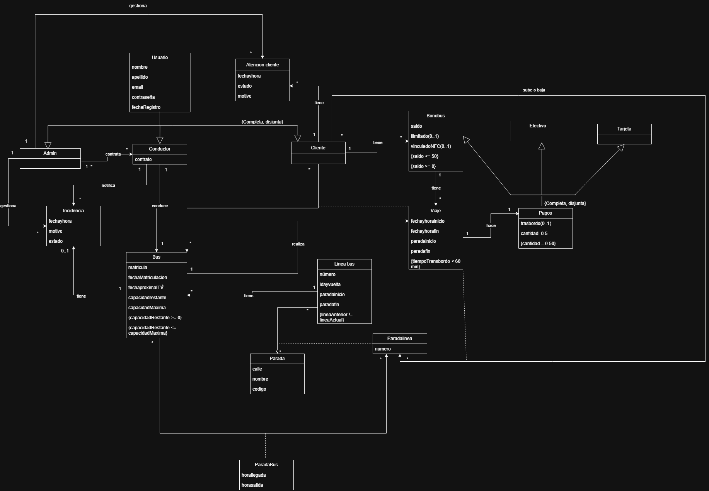

### 7.2. Escenarios de prueba

En este apartado se representan los escenarios de prueba del sistema SmartBus mediante diagramas de objetos UML.

Cada escenario incluye una descripción textual de la situación planteada, el resultado esperado y un diagrama de objetos que representa las instancias de las clases implicadas y sus relaciones.

#### EP-01. Registro de un cliente y asignación de bonobús

**Historia relacionada:** HU-01.

**Descripción textual:**

Un nuevo usuario accede a SmartBus y realiza su registro introduciendo su nombre, apellidos, correo electrónico y contraseña. El sistema crea un objeto de tipo Cliente, almacena sus datos personales y registra su fecha de alta. A continuación, se le asigna un bonobús virtual que queda asociado a su cuenta.

**Resultado esperado:**

El cliente queda registrado correctamente y existe una asociación entre el objeto Cliente y su correspondiente Bonobús. El sistema permite identificar qué bonobús pertenece al usuario.

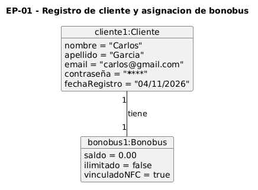

#### EP-02. Consulta de las paradas de una línea

**Historia relacionada:** HU-02.

**Descripción textual:**

Un pasajero accede a la aplicación y selecciona una línea de autobús que tiene tres paradas registradas: Parada A, Parada B y Parada C. Estas paradas están asociadas a la línea mediante sus correspondientes registros de ParadaLinea, indicando el orden que ocupan dentro del recorrido.

Cuando el pasajero consulta la línea, el sistema recupera las paradas y las muestra siguiendo el orden establecido.

**Resultado esperado:**

La aplicación muestra las tres paradas correctamente ordenadas, permitiendo identificar el recorrido completo de la línea.

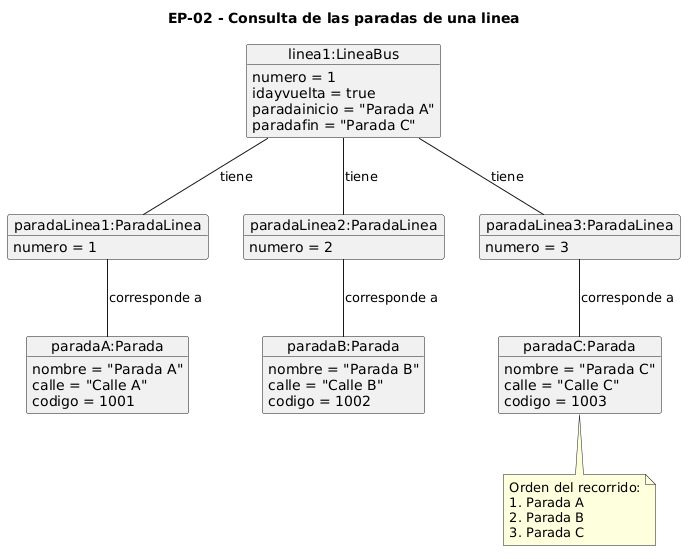

#### EP-03. Consulta de la ubicación y tiempo estimado de llegada

**Historia relacionada:** HU-03.

**Descripción textual:**

Un pasajero se encuentra esperando en la Parada D de una línea cuyo recorrido está formado por las paradas A, B, C y D.

Un autobús ha completado su paso por la Parada B, por lo que el sistema registra esta última parada como su ubicación conocida.

Si el tiempo estimado para recorrer cada tramo pendiente es de tres minutos, el sistema calcula que el autobús tardará aproximadamente seis minutos en llegar a la Parada D.

**Resultado esperado:**

La aplicación muestra la Parada B como última parada registrada del autobús y presenta una estimación de llegada de seis minutos a la Parada D.

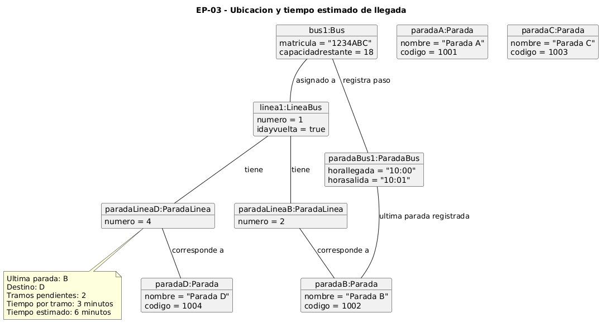

#### EP-04. Actualización de la ocupación del autobús

**Historia relacionada:** HU-04.

**Descripción textual:**

Un autobús tiene una capacidad máxima de 40 pasajeros y actualmente transporta a 20 personas.

Al llegar a una parada, seis pasajeros suben al vehículo y cuatro se bajan. Tras el cierre de puertas, el sistema registra las nuevas entradas y salidas y actualiza el número de viajeros a bordo.

La ocupación resultante es de 22 pasajeros, por lo que quedan 18 plazas disponibles.

**Resultado esperado:**

El sistema actualiza la ocupación del autobús a 22 pasajeros y su capacidad restante a 18 plazas. Esta información queda disponible para los usuarios de las siguientes paradas.

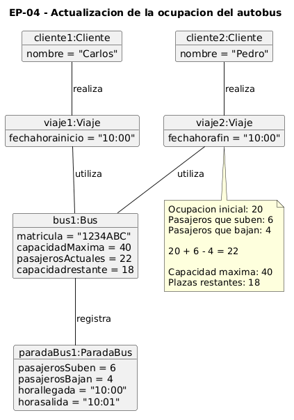

#### EP-05. Autobús que alcanza su capacidad máxima

**Historia relacionada:** HU-05.

**Descripción textual:**

Un autobús con capacidad máxima para 40 pasajeros transporta actualmente a 39 personas.

En la siguiente parada, un nuevo pasajero valida correctamente su viaje y accede al vehículo. El sistema incrementa el número de pasajeros a 40, alcanzando así su capacidad máxima.

Como consecuencia, el autobús pasa al estado "Completo", impidiendo que se emitan nuevos billetes virtuales para ese vehículo mientras permanezca lleno.

**Resultado esperado:**

El autobús aparece identificado como completo y su capacidad restante es de cero plazas. La aplicación oculta el tiempo de llegada de ese vehículo para los usuarios de las siguientes paradas, según la regla de negocio definida.

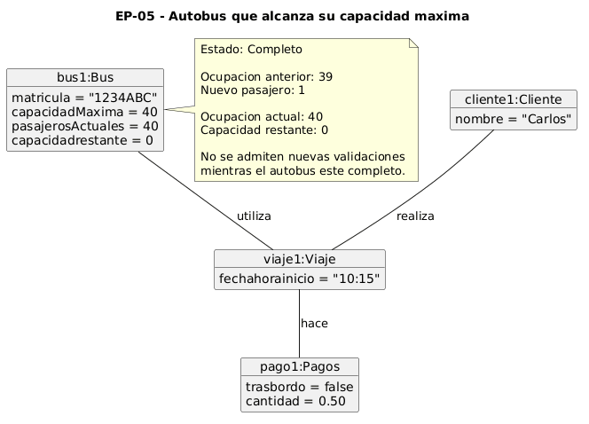

#### EP-06. Validación de un viaje con bonobús virtual

**Historia relacionada:** HU-06.

**Descripción textual:**

Un cliente tiene un bonobús virtual con un saldo disponible de 1,50 € y desea subir a un autobús.

Al acercar su teléfono móvil al lector NFC, el sistema comprueba que el bonobús dispone de saldo suficiente para pagar la tarifa ordinaria de 0,50 €.

La validación se autoriza, se registra el viaje y se descuenta el importe correspondiente, dejando un saldo de 1,00 €.

También se comprueba el caso de un cliente cuyo bonobús dispone únicamente de 0,30 €. En esta situación, el sistema debe rechazar la validación porque el saldo es insuficiente.

**Resultado esperado:**

Cuando existe saldo suficiente, se registra el viaje, se genera el pago correspondiente y se actualiza el saldo del bonobús. Cuando el saldo es insuficiente, se rechaza la operación sin descontar dinero ni registrar un viaje válido.

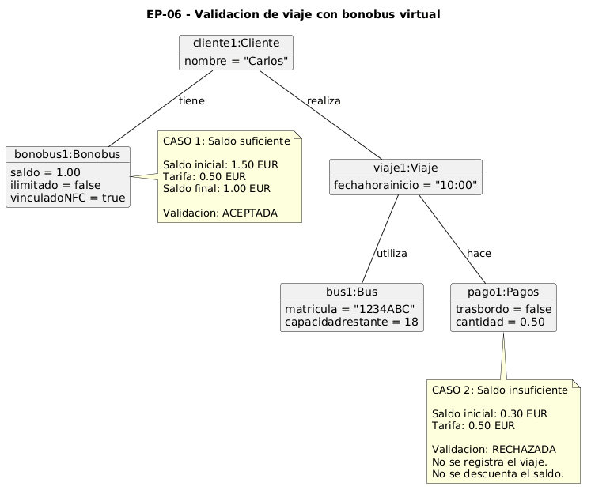

#### EP-07. Recarga del saldo del bonobús virtual

**Historia relacionada:** HU-07.

**Descripción textual:**

Un cliente dispone de un bonobús virtual con un saldo de 44 € y solicita una recarga de 5 € desde la aplicación.

El sistema comprueba que el importe cumple el mínimo de recarga establecido y que el saldo resultante no supera el máximo permitido de 50 €.

La operación se autoriza y el saldo del bonobús pasa a ser de 49 €.

Posteriormente, se prueba una recarga de 5 € sobre un bonobús que ya dispone de 48 €. En este caso, la operación debe rechazarse porque el saldo resultante superaría el máximo permitido.

También se comprueba que una recarga inferior a 5 € sea rechazada.

**Resultado esperado:**

El sistema permite las recargas que cumplen las restricciones y rechaza aquellas que no respetan el importe mínimo o el saldo máximo establecido.

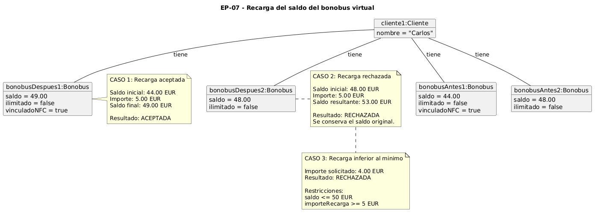

#### EP-08. Aplicación del descuento por transbordo

**Historia relacionada:** HU-08.

**Descripción textual:**

Un cliente realiza un viaje en la Línea 1 utilizando su bonobús virtual. El sistema registra la fecha y hora de validación y el pago correspondiente.

Cuarenta minutos después, el mismo cliente sube a un autobús de la Línea 2 y vuelve a utilizar su bonobús.

Al identificar que se trata de una línea diferente y que no ha transcurrido una hora desde la primera validación, el sistema reconoce el segundo viaje como transbordo y aplica el descuento correspondiente.

Se comprueba también que el descuento no se aplique cuando el segundo viaje se realiza en la misma línea o cuando han transcurrido 60 minutos o más.

**Resultado esperado:**

El segundo pago queda identificado como transbordo y se aplica el descuento cuando se cumplen las condiciones. En caso contrario, se utiliza la tarifa ordinaria.

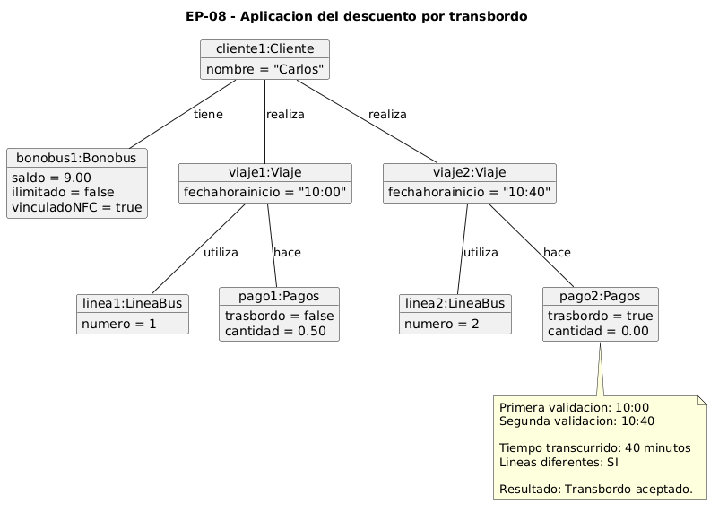

#### EP-09. Solicitud de parada de bajada

**Historia relacionada:** HU-09.

**Descripción textual:**

Un pasajero se encuentra viajando en un autobús de la Línea 5 y tiene una validación activa asociada a dicho vehículo.

El autobús acaba de superar la Parada B y la siguiente parada de su recorrido es la Parada C.

El pasajero accede a la aplicación y solicita bajarse en la Parada C.

El sistema comprueba que el cliente tiene un viaje activo en ese autobús y que la parada solicitada es posterior a la última parada registrada.

Una vez verificados estos datos, la solicitud se comunica al conductor.

**Resultado esperado:**

El sistema acepta la solicitud e informa al conductor de que debe detenerse en la Parada C.

Si el cliente no tiene una validación activa en ese autobús, la aplicación rechaza la solicitud.

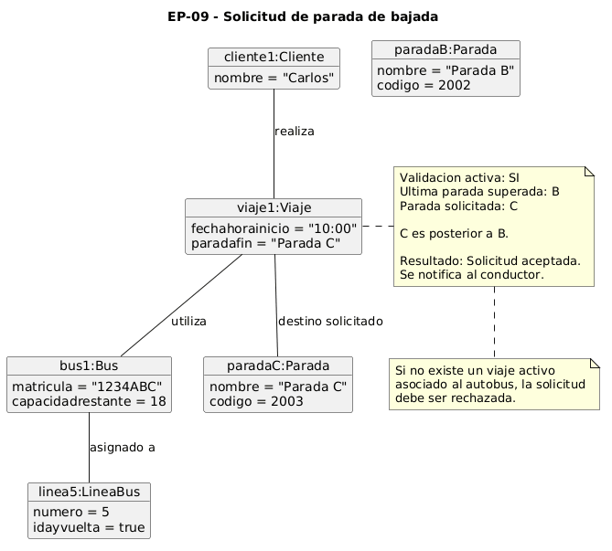

#### EP-10. Notificación de avería de un autobús

**Historia relacionada:** HU-10.

**Descripción textual:**

Un conductor está realizando un servicio en un autobús asignado a una línea determinada.

Durante el recorrido, el vehículo sufre una avería que le impide continuar. El conductor accede al sistema y selecciona la opción de notificar una avería crítica.

El sistema registra una incidencia vinculada al conductor, almacenando la fecha, la hora y el motivo de la avería.

A continuación, el autobús queda marcado como inactivo en su última parada registrada.

Las previsiones de llegada de ese vehículo desaparecen de las paradas posteriores y el contador de ocupación del sistema se actualiza a cero, según lo establecido en los requisitos.

**Resultado esperado:**

La incidencia queda registrada con estado inicial "Enviada" y asociada al conductor. El autobús cambia su estado a "Inactivo" y deja de aparecer como un vehículo disponible para continuar el recorrido.

El administrador puede consultar posteriormente la incidencia y actualizar su estado a "En proceso" o "Solucionada".

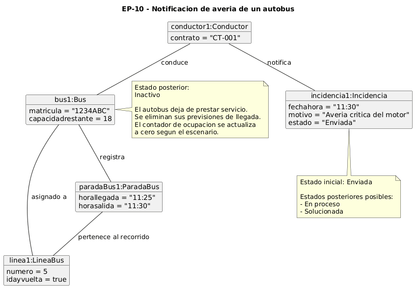

## 8. Matrices de trazabilidad

- Matriz de trazabilidad entre los elementos del modelo conceptual y los requisitos.

| Requisitos | Entidad(es) implicada(s) | Asociación(es) | Restricción(es) |
|:---|:---|:---|:---|
| **R.I.01** | `Usuario` | | Atributos de Usuario obligatorios |
| **R.I.02** | `Admin`, `Usuario`, `Incidencia` | `gestiona` (Admin-Usuario), `gestiona` (Admin-Incidencia)| `{Completa, disjunta}` (Usuarios) |
| **R.I.03** | `Conductor`, `Bus` | `conduce` (Conductor-Bus) | `{Completa, disjunta}` (Usuarios) |
| **R.I.04** | `Cliente`, `Bonobus` | `tiene` (Cliente-Bonobus) | `{Completa, disjunta}` (Usuarios) |
| **R.I.05** | `Incidencia`, `Conductor` | `notifica` (Conductor-Incidencia) | `estado` (enviada, en proceso, solucionada) |
| **R.I.06** | `Bus`, `Linea bus` | `tiene` (Linea bus-Bus) | `capacidadrestante >= 0` |
| **R.I.07** | `Linea bus`, `ParadaLinea` | `tiene` (Linea bus-Parada) | |
| **R.I.08** | `Parada` | | |
| **R.I.09**| `ParadaLinea`, `Linea bus`, `Parada`| Asociaciones con tabla intermedia | |
| **R.I.10** | `ParadaBus`, `Bus`, `Parada` | Asociaciones con tabla intermedia | |
| **R.I.11** | `Atencion cliente`, `Cliente`, `Admin`| `tiene` (Cliente-Atencion), `gestiona` (Admin) | |
| **R.I.12** | `Viaje`, `Cliente` | `realiza` (Cliente-Viaje) | |
| **R.I.13** | `Pagos`, `Viaje` | `hace` (Viaje-Pagos) | `cantidad=0.5` |
| **R.I.14** | `Bonobus`, `Pagos` | | `{Completa, disjunta}` (Pagos) |
| **R.I.15** | `Efectivo`, `Pagos` | | `{Completa, disjunta}` (Pagos) |
| **R.I.16** | `Tarjeta`, `Pagos` | | `{Completa, disjunta}` (Pagos) |
| **R.F.01** | `Bus`, `ParadaBus` | | |
| **R.F.02** | `Bus` | | Lectura de `capacidadrestante` |
| **R.F.03** | `Bus` | | `capacidadrestante <= total` |
| **R.F.04**| `Bus`, `Cliente` | `sube o baja` (Cliente-Bus) | Actualización de aforo |
| **R.F.05**| `Linea bus`, `ParadaLinea` | `tiene` (Linea bus-Parada) | Orden numérico estricto |
| **R.F.06** | `Parada`, `Bus` | | |
| **R.F.07** | `Pagos`, `Viaje` | `hace` (Viaje-Pagos) | `{Completa, disjunta}` (Pagos) |
| **R.F.08** | `Bonobus` | | |
| **R.F.09** | `Viaje`, `Pagos` | `hace` (Viaje-Pagos) | `trasbordo(0..1)` |
| **R.F.10**| `Bus`, `Incidencia` | `notifica` (Conductor-Incidencia) | |
| **R.F.12** | `Bonobus` | | `saldo` acumulable |
| **R.F.16**| `Viaje`, `Parada` | `realiza` (Cliente-Viaje) | Selección de `paradafin` |
| **R.F.17** | `Conductor`, `Incidencia` | `notifica` (Conductor-Incidencia) | |
| **R.F.18** | `Conductor`, `Incidencia` | `notifica` (Conductor-Incidencia) | |
| **R.N.01** | `Bonobus` | | `saldo >= 0.5` |
| **R.N.02**| `Bus` | | `capacidadrestante = 0` |
| **R.N.03**| `Bonobus` | | `saldo <= 50` |
| **R.N.04**| `Bus` | | `capacidadrestante >= 0` |
| **R.N.05** | `Bonobus`, `Viaje` | `realiza` (Cliente-Viaje) | Límite temporal de validaciones |
| **R.N.06**| `Viaje`, `Pagos` | `hace` (Viaje-Pagos) | Correspondencia de billetes |
| **R.N.07** | `Viaje` | `realiza` (Cliente-Viaje) | Margen < 1 hora en `fechahorainicio` |
| **R.N.08** | `Pagos` | | `cantidad=0.5` |
| **R.N.09** | `Viaje`, `Parada` | `realiza` (Cliente-Viaje) | Validación activa requerida |
| **R.N.10**| `Viaje`, `Linea bus` | | Distinta línea para trasbordo |
| **R.N.11**| `Bonobus` | | Recarga >= 5.00 |

-- fin entregable 2 --

## 89. Modelo relacional en 3FN

- Relaciones obtenidas al aplicar la transformación del modelo conceptual.

### 9.1.  Justificación de la estrategia de transformación de jerarquías

- si se identificaron jerarquías en el MC.

### 10. Matriz de trazabilidad MC/SQL (opcional):

- Restricciones sobre el MC / Elementos del modelo tecnológico (SQL) (Triggers, checks, etc.)
- Incluir Reglas de negocio — Constraints/Triggers en las matrices de trazabilidad para el entregable 3

|       | EntidadX   | AsociaciónX  | RestricciónX  | Entidad2 ...   | 
|:-------|:-------|:-------|:-------|:-------|
| TABLA-1 |        |        |        |        |
| TABLA-2 |        |        |        |        |
| TABLA-3 |        |        |        |        |
| TABLA-4 |        |        |        |        |
| TRIG-1 |        |        |        |        |
| TRIG-2 | X      | X      |        | X      |
| TRIG-3 |        | X      |        | X      |
| TRIG-4 |        |        | X      |        |
| CONST-1 |        |        |        |        |
| CONST-2 | X      | X      |        | X      |
| CONST-3 |        | X      |        | X      |
| CONST-4 |        |        | X      |        |

Se consideran todo tipo de constraints declarativas (aquellas definidas durante el CREATE TABLE).
-- fin entregable 3 --

## Referencias

